# 智能校园广播系统

[](https://github.com/Dg-Isary/BoardcastSystemNew/actions/workflows/build.yml)

> **下载**：[最新 Release](https://github.com/Dg-Isary/BoardcastSystemNew/releases/latest) —— 电脑端安装包（含开源版）与安卓 APK，附 SHA256 校验值。

面向中小学的**校园广播与打铃系统**。一台 Windows 电脑作为主机负责打铃、播控与定时任务，
师生用浏览器打开网页看板、老师用手机 App 远程喊话与改排程 —— 三端共用同一份配置。

- **电脑端**：.NET 8 / WPF 单进程应用（内置 Kestrel HTTP 服务），自包含单文件发布，**无需另装运行时**
- **网页看板**：电脑端自带，同一局域网内任何设备打开浏览器即可控制
- **手机端**：Kotlin / Jetpack Compose（Android 8.0+），经内置 vnt-lite 组网隧道接入，不需要虚拟网卡、不需要管理员权限

> 当前版本 **4.1.0**。版本历史与兼容性说明见 [VERSION.md](VERSION.md)。

### 界面速览

| 运行总览 | 任务排程 |
|:---:|:---:|
| [](Screenshot/Dashboard.png) | [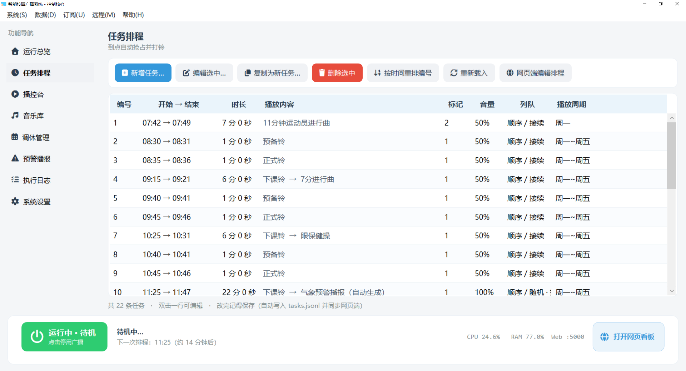](Screenshot/Task.png) |
| **播控台** | **网页看板** |
| [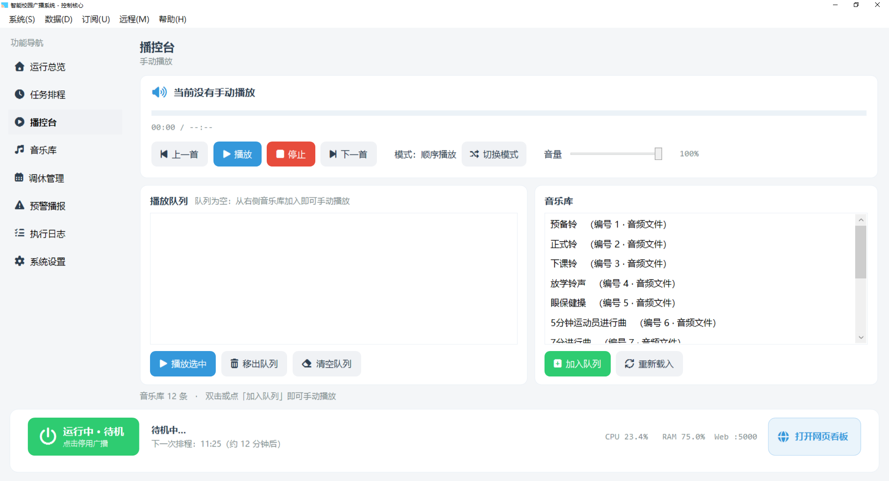](Screenshot/PlayControl.png) | [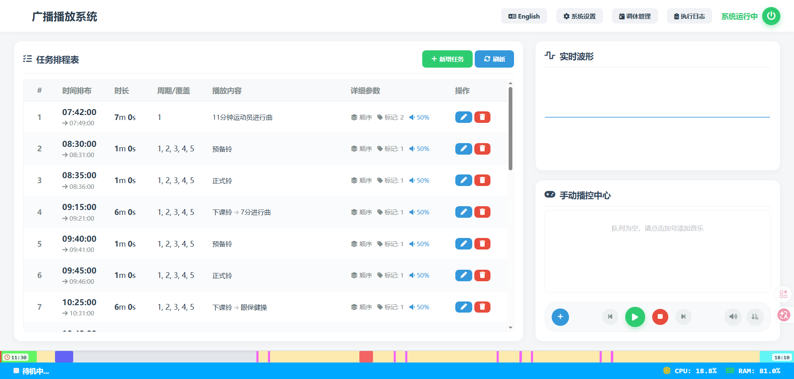](Screenshot/WebDashBoard.png) |

<sub>点击任一图片可查看原图。完整界面（音乐库、调休管理、气象预警、导入导出、话筒、vnt 设置、管理员赋权）见 [第二节 · 功能完成情况](#二功能完成情况界面截图)。</sub>

---

## 目录

- [一、功能一览](#一功能一览)
- [二、功能完成情况（界面截图）](#二功能完成情况界面截图)
- [三、系统要求](#三系统要求)
- [四、安装与升级](#四安装与升级)
- [五、快速上手](#五快速上手)
- [六、数据位置与备份（重要）](#六数据位置与备份重要)
- [七、网页看板与手机端](#七网页看板与手机端)
- [八、从源码构建](#八从源码构建)
- [九、项目结构](#九项目结构)
- [十、数据格式速查](#十数据格式速查)
- [十一、调休判定规则](#十一调休判定规则)
- [十二、常见问题](#十二常见问题)
- [十三、第三方组件与许可](#十三第三方组件与许可)

---

## 一、功能一览

| 分类 | 能力 |
|---|---|
| **定时打铃** | 按星期 / 指定日期排程；到点自动抢占当前播放；每任务独立音量、时长上限、列队模式、单次提歌数 |
| **排程播控** | 音乐库（本地文件 / 目录 / HLS 流）→ 任务序列；支持顺序、随机、目录断点续播 |
| **调休规则** | 手动规则 + 云端订阅（`holiday-cn` / 程序原生格式），支持 1–10 分标记规则与全局规则 |
| **气象预警播报** | 订阅气象预警，命中播报窗口时**离线语音合成**播报（Windows SAPI），可随调休规则联动 |
| **远程喊话** | 手机当话筒：动态配对码 + X25519 会话密钥 + AES-GCM 加密音频，电脑端用 ffplay 实时播放 |
| **组网** | 内置 vnt-lite 客户端（自实现握手 / P2P 打洞 / 中继 / 服务端加密），手机无需虚拟网卡 |
| **三端同源** | 电脑端、网页看板、手机端读写**同一份配置文件**，改动立即互通 |
| **数据搬运** | 按项导入 / 导出（排程、调休、预警配置、系统设置、vnt、音乐库、铃声），带合法性校验与旧格式迁移 |
| **界面** | 左侧导航 + 底部状态条 + 托盘状态标记（形状+颜色区分运行/停用/无排程）+ 悬浮球；对话框全部自绘，不用系统 MessageBox |

---

## 二、功能完成情况（界面截图）

桌面端共 **8 个功能页 + 7 个对话框**，均已实现并可用。下表是总览，
每项下面是**默认展开**的界面截图与功能说明，直接往下看即可。

> 网页看板与手机端的界面截图见 [第七节](#七网页看板与手机端)。

| # | 功能 | 类型 | 状态 |
|---|---|---|---|
| 1 | [运行总览](#1-运行总览) | 功能页 | 已完成 |
| 2 | [任务排程](#2-任务排程) | 功能页 | 已完成 |
| 3 | [任务编辑窗](#3-任务编辑窗) | 对话框 | 已完成 |
| 4 | [播控台](#4-播控台) | 功能页 | 已完成 |
| 5 | [音乐库](#5-音乐库) | 功能页 | 已完成 |
| 6 | [调休管理](#6-调休管理) | 功能页 | 已完成 |
| 7 | [云端调休订阅设置](#7-云端调休订阅设置) | 对话框 | 已完成 |
| 8 | [本地导入调休数据](#8-本地导入调休数据) | 对话框 | 已完成 |
| 9 | [预警播报](#9-预警播报) | 功能页 | 已完成 |
| 10 | [执行日志](#10-执行日志) | 功能页 | 已完成 |
| 11 | [系统设置](#11-系统设置) | 功能页 | 已完成 |
| 12 | [导入 / 导出](#12-导入--导出) | 对话框 | 已完成（4.0.0 新增） |
| 13 | [话筒](#13-话筒) | 对话框 | 已完成 |
| 14 | [vnt 设置](#14-vnt-设置) | 对话框 | 已完成 |
| 15 | [管理员（设备赋权）](#15-管理员设备赋权) | 对话框 | 已完成 |

### 1. 运行总览

**功能页** —— 系统状态、播放情况与常用入口


- 顶部总开关状态与一键启用 / 停用；
- 当前播放内容与**下一次排程**倒计时；
- 主机资源与端口占用（CPU / 内存 / HTTP 端口）；
- 组网状态与本机在虚拟网里的地址；
- 「打开网页看板」入口（其它电脑 / 手机用浏览器控制）。

### 2. 任务排程

**功能页** —— 定时打铃任务的增删改查


- 列表按开始时间排序，显示「编号 / 开始→结束 / 时长 / 播放内容 / 标记 / 音量 / 列队 / 播放周期」；
- 新增 / 编辑走弹窗（见下一项），删除即时生效；
- **「按时间重排编号」**：把全部任务按开始时间重新编号为 1~N 并写回配置（编号是任务的对外标识）；
- 与网页端、手机端**共用同一份 `tasks.jsonl`**，任一端改动另两端刷新即可见。

### 3. 任务编辑窗

**对话框** —— 新增或编辑单条打铃任务

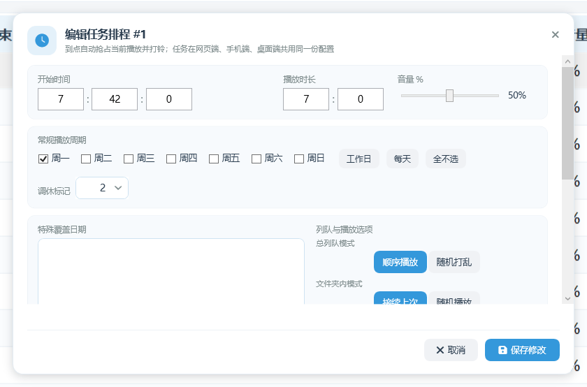

窗口标题栏显示 **「新增任务排程」** 或 **「编辑任务排程」**；窗口内的标题在编辑时还会带上任务编号
（例如 **「编辑任务排程 #12」**）。
窗口顶部还有一句用途说明：**到点自动抢占当前播放并打铃；任务在网页端、手机端、桌面端共用同一份配置**。

#### 左列：时间与触发条件

| 字段 | 取值范围 | 说明 |
|---|---|---|
| **开始时间** | 时 0–23 : 分 0–59 : 秒 0–59（默认 `08:00:00`） | 可直接输入，也可以在输入框上滚轮调节 |
| **播放时长** | 分 0–599 : 秒 0–59 | **填 0 分 0 秒表示完整播放**整首（或整个目录），不中途截断 |
| **音量 %** | 0–100（默认 100） | 本条任务自己的播放音量，拖动滑杆设置 |
| **常规播放周期** | 周一 ~ 周日，可多选 | 与「特殊覆盖日期」是**或**的关系，任一命中即执行。旁边有三个快捷按钮：**工作日**（周一至周五）/ **每天** / **全不选** |
| **调休标记** | **1–10** | 决定这条任务受哪一组调休规则控制：**只受同标记的规则影响**。（标记 0 是全局规则，只在「调休管理」页里用，这里选不到） |
| **特殊覆盖日期** | 每行一个日期，如 `2026-05-01` | 也支持逗号分隔（中英文逗号都行）。先在右侧日历里选一个日期，再点「加入」；没选日期就点会提示"请先在上面的日历里选一个日期，再点「加入」" |

#### 右列：列队与播放选项（四项，自上而下）

| 选项 | 取值 | 说明 |
|---|---|---|
| **总列队模式** | `顺序播放` / `随机打乱` | 整个播放序列按什么顺序放 |
| **文件夹内模式** | `接续上次` / `随机播放` | 只对**目录型**音频生效：接着上次的断点继续，还是每次都重新随机 |
| **单次提歌数** | 1–99（默认 1） | 只对**目录型**音频生效：一次取几首 |
| **到达时间后** | `立即终止` / `播完当前` | **只描述本任务到达自己的结束时间时怎么停**：`立即终止` = 到点立刻切掉正在播的那一首；`播完当前` = 等这一首自然放完再结束本任务（第 n 首播完即停）。**任务与任务之间一律立即抢断，不受这一项影响** |

#### 播放内容（底部两栏）

- 左栏 **「音乐库」**：可按名称或编号筛选，**双击**曲目或点「加入」把它放进右侧序列；
- 右栏 **「已选播放序列」**：**按从上到下的顺序播放**，可「上移」「下移」「清空」。

#### 保存前的提示（只提示，不阻止保存）

窗口内会实时显示两类提示：

- **还没有选择播放内容**；
- **既没选星期也没有特殊日期 → 这条任务永远不会触发**。

> 这两条只是提醒，点「保存修改 / 新增任务」仍会照常保存。

#### 底部按钮

`取消`（按 Esc 也可关闭）/ **`新增任务`**（新建时）或 **`保存修改`**（编辑时）。

> 4.0.0 起本窗改为**底部按钮固定、正文滚动**的三行布局，高缩放（150% / 175%）下按钮不会再被挤出屏幕。

### 4. 播控台

**功能页** —— 手动播放与播放队列


- 上/下一首、播放/暂停/停止、进度条、模式切换（顺序 / 列表循环 / 单曲循环）、音量滑杆；
- 左侧播放队列（当前曲高亮、双击播放选中、移出、清空），右侧音乐库（双击或「加入队列」，目录型自动展开）；
- 走与网页端**同一个** `/api/player/cmd` 接口；状态复用主窗口轮询结果，不额外打接口。

### 5. 音乐库

**功能页** —— 音频资源管理

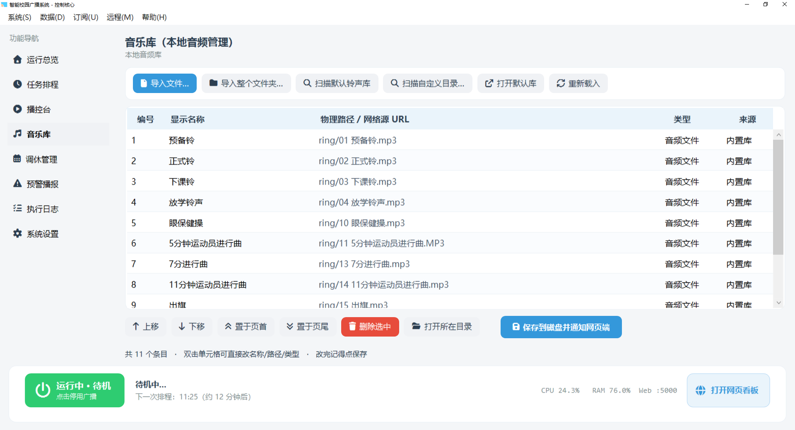

- 支持三种类型：本地文件、目录（顺序/随机取 N 首、可断点续播）、HLS 网络流；
- 「扫描默认铃声库」一键导入随包铃声；也可拖入或手动添加；
- **编号稳定策略**：编号一经分配不再变化，删除只留空缺、新增顶替最小空缺；
- 编号 1000 保留给气象预警播报，不会被普通条目占用。

### 6. 调休管理

**功能页** —— 放假 / 补班规则

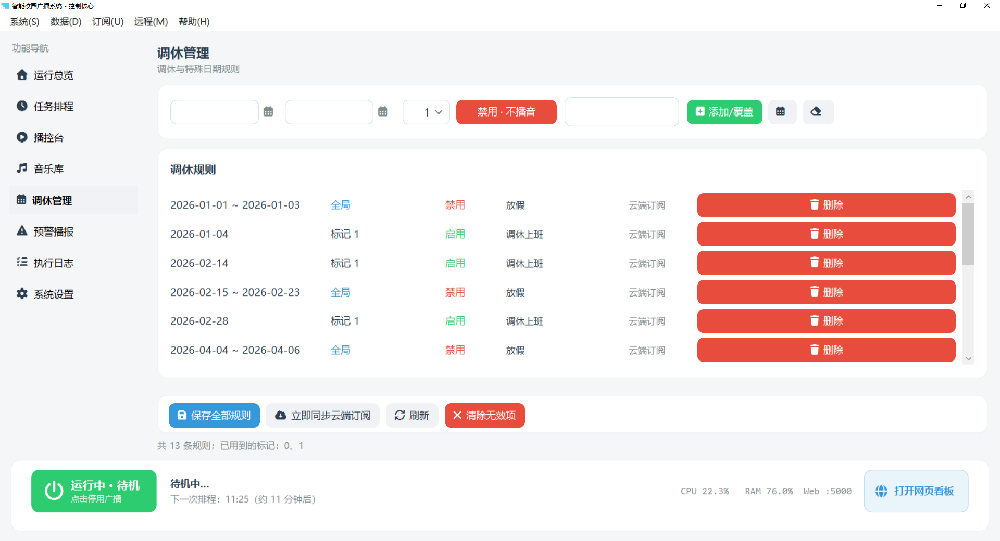

- 手动添加规则：日期、标记（0–10，0 为全局）、动作（放假不播 / 补班照常）、备注；
- 日期区间自动合并；手动规则**优先于**云端规则；
- 云端拉到的非法数据单独列出（红字删除线提示）并可一键清除。

### 7. 云端调休订阅设置

**对话框** —— 订阅源与同步

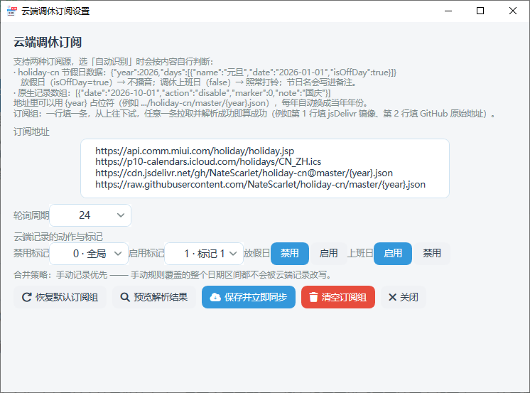

- **格式始终自动识别**（按内容判断，**不需要设置、也没有格式选项**）—— 支持**四种订阅源**：

  | 来源 | 形状 | 转写规则 |
  |---|---|---|
  | **小米节假日接口** | `api.comm.miui.com/holiday/holiday.jsp` 返回的逐日数据 | 放假日 → `disable`（不播音）；调休上班日 → `enable`（照常打铃） |
  | **苹果 iCloud 日历（ICS）** | `p10-calendars.icloud.com/holidays/CN_ZH.ics` | 只认带 `X-APPLE-SPECIAL-DAY` 的事件：`WORK-HOLIDAY` → 放假日、`ALTERNATE-WORKDAY` → 调休上班日 |
  | **holiday-cn JSON** | `{"year":2026,"days":[{"name":"元旦","date":"2026-01-01","isOffDay":true}]}` | `isOffDay=true` → 放假；`false` → 补班照常；`name` → 备注 |
  | **程序原生 JSON** | `[{"date":"2026-10-01","action":"disable","marker":0,"note":"国庆"}]` | 原样写入 |

- **内置默认订阅组共 4 条**（一行一条，从上往下试，任意一条拉取并解析成功即算成功）：
  小米接口 → 苹果 iCloud 日历 → holiday-cn（jsDelivr 镜像，国内可直连）→ holiday-cn（GitHub 原始地址）。
- **`{year}` 占位符**只用于按年下发的地址（如 holiday-cn 的 `.../master/{year}.json`），每年自动换成当年；
  **小米与苹果是多年接口，地址里不带占位符**。
- **苹果日历为什么能直接用**（程序内部已处理这三个坑）：
  ① 只有带 `X-APPLE-SPECIAL-DAY` 的事件才算真节假日 —— 小寒 / 大寒 / 立春 / 妇女节 / 元宵节 这类只有标题的
  事件必须忽略，否则每个节气都会被当成"放假不打铃"；② `DTEND` 是**不含**的
  （`DTSTART=20231230` + `DTEND=20240102` 表示 12-30 ~ 01-01）；③ 日历含多年数据，程序只取**当年与下一年**。
- **云端记录的动作与标记可调**：放假日 / 上班日分别写成 `禁用` 或 `启用`，并各带一个标记
  （0 = 全局，1–10 = 只影响绑定了同标记的任务）。
- **合并策略**：手动记录优先 —— 被手动规则覆盖的整个日期区间都不会被云端记录改写。
- **「预览解析结果」**先拉取 + 转写、只显示条数与样例、**不写库**，确认无误再「保存并立即同步」；
- 「恢复默认订阅组」一键填回内置 4 条；「清空订阅组」= 关闭云端订阅（之后不再自动拉取）。

### 8. 本地导入调休数据

**对话框** —— 网络拉不到订阅时的兜底

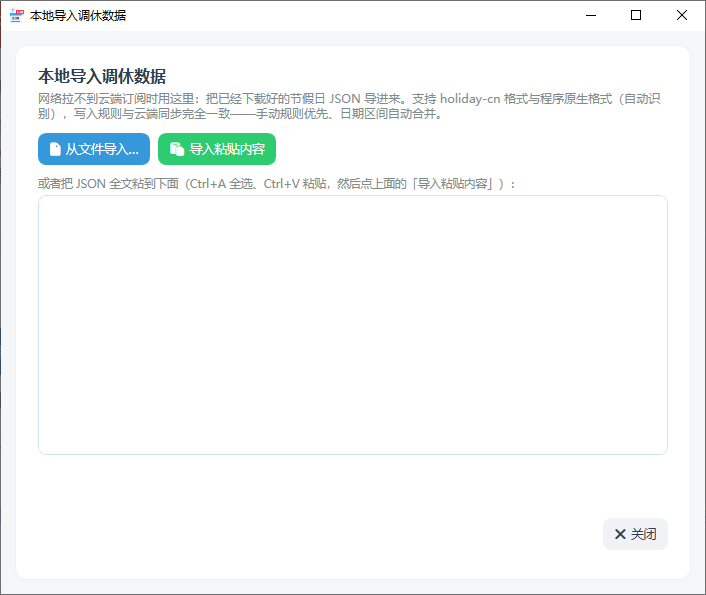

- 从本地文件导入，或直接把内容全文粘进文本框；
- 与云端订阅是**同一套自动识别**：小米接口 / 苹果 iCloud 日历（ICS）/ holiday-cn / 程序原生 JSON **四种都能认**
  （粘贴框里放 ICS 文本也可以）；
- 写入规则与云端同步**完全一致**（手动规则优先、区间自动合并），并报告生效条数、覆盖天数、被手动规则压住的条数、非法条数。

### 9. 预警播报

**功能页** —— 气象预警订阅与播报

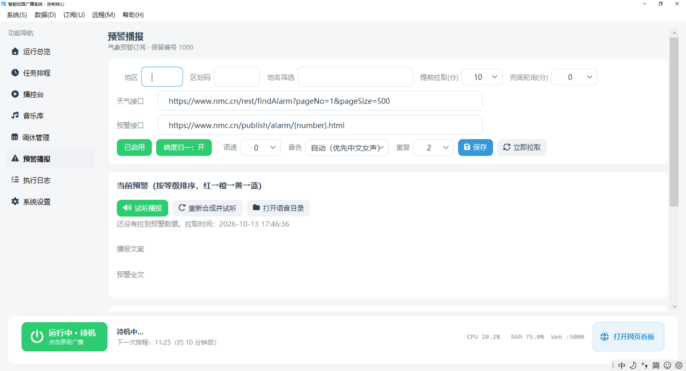

- 订阅气象预警，按**播报窗口**（星期 + 时间段）与预报节点判断是否播报；
- 离线语音合成（Windows SAPI），可选音色、语速、重复遍数，并做**响度归一**（否则比音乐小声听不见）；
- 可跟随调休规则（放假不播）；
- 默认关闭兜底轮询，改为**排程点前按需拉取**，大幅减少请求数；
- 编号 1000 即"当前预警播报"，在排程里选中它即可定时播报。

### 10. 执行日志

**功能页** —— 每次触发、播放、抢占、引用失效与配置变更

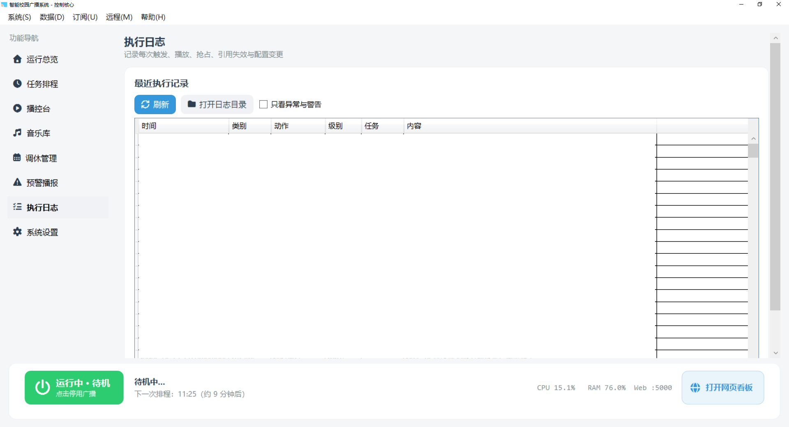

- 记录打铃触发、播放、抢占、引用失效、配置变更、组网与话筒事件；
- 可按类别与级别筛选，支持只看异常与警告；
- 日志按天落盘（`logs\play-YYYY-MM-DD.jsonl`），保留 30 天。

### 11. 系统设置

**功能页** —— 最小必要项

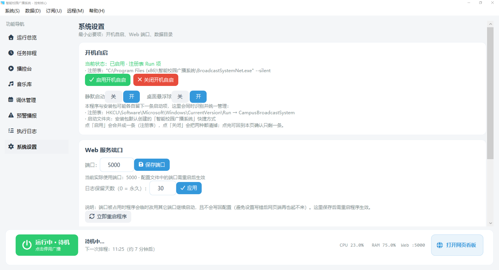

- 开机自启（写入启动项，与安装脚本统一成一条）；
- 网页看板端口（默认 5000，程序会自动选可用端口）；
- 数据目录入口与打开日志目录。

### 12. 导入 / 导出

**对话框** —— 4.0.0 新增的按项数据搬运

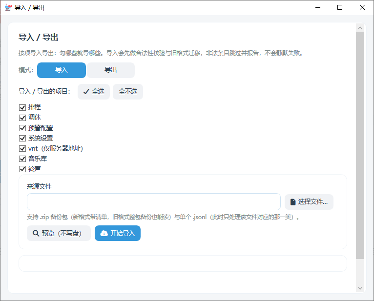

- **一个窗口 + 中文复选**：排程 / 调休 / 预警配置 / 系统设置 / vnt（仅服务器地址）/ 音乐库 / 铃声；
- **导出默认不含隐私数据**（网页口令、组网令牌、数据密码、凭证密钥）；勾选导出隐私需醒目二次确认；
- 导入分三步：选择文件 → **预览（不写盘）** → 导入；预览会报告"将写入 / 跳过 / 非法"的条数；
- **「完全覆盖」**仅在来源主机名与本机一致时出现，执行前二次确认；
- 逐项规则：排程追加去重（完全覆盖时全量替换并按时间重排编号）、调休按日期+标记+动作去重、
  音乐库只导入编号不冲突项、铃声同名覆盖不同名新增、预警只导入配置不导入历史；
- **vnt 的设备 ID、组网令牌、数据密码、凭证密钥、动态码种子永不覆盖**（跨机只取服务器地址）；
- 同一批导入器也被「拖入页面」与「从备份中恢复」复用，因此校验规则只有一份。

### 13. 话筒

**对话框** —— 开麦与动态配对码


- 一键开麦 / 关麦，显示当前 6 位**动态配对码**（60 秒轮换）与已连接设备；
- 可调单次时长上限、最大会话数、迟到帧丢弃阈值；
- 会话状态（丢包率、迟到帧、重放拦截数）用于排障；
- 手机喊话走 X25519 会话密钥 + AES-GCM 加密音频，电脑端用 ffplay 实时播放。

### 14. vnt 设置

**对话框** —— 组网参数与二维码

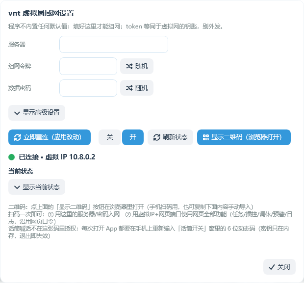

- 填组网服务器、令牌、数据密码，选择加密方式与是否校验指纹；
- **生成二维码**供手机扫码配置（二维码里带齐"能决定手机端能否通信"的全部字段）；
- 显示连接状态与本机在虚拟网里的地址；支持自动重连与信任设备名单。

### 15. 管理员（设备赋权）

**对话框** —— 手机端权限


- 给手机设备赋权：管理员 / 普通两档；
- 只有**管理员设备**才能改排程与调休（读接口与播控不受限）；
- 凭证由电脑端自动生成、界面不显示；可随时收回权限。

---

## 三、系统要求

### 主机（电脑端）

| 项 | 要求 |
|---|---|
| 操作系统 | Windows 10 / 11（x64）。已在 Windows 10 上验证 |
| 运行时 | **无需安装** —— 安装包是自包含单文件发布（约 130 MB，内含 .NET 运行时） |
| 磁盘 | 安装后约 400 MB（程序 + 随包的 ffmpeg/ffplay + 前端库） |
| 网络 | 局域网；若要用手机端与网页远程访问，需要主机与手机在同一网络（或能连到组网服务器） |
| 音频 | 主机需要能出声的音频输出设备（打铃与喊话都经它播放） |
| 语音播报 | 气象预警播报依赖 **Windows 中文语音包（SAPI）**；没有中文语音时该项自动跳过，其余功能不受影响 |

### 手机端

| 项 | 要求 |
|---|---|
| 系统 | Android 8.0（API 26）及以上 |
| 权限 | 麦克风（喊话）、相机（扫二维码配置）、通知 |
| 安装 | 直接安装 APK（未上架应用商店） |

### 网页看板

现代浏览器（Chrome / Edge / Firefox / Safari 均可）。图表、日历、图标库**优先从 CDN 加载**，
取不到时自动回落到主机本地副本，因此断网也能完整显示。

---

## 四、安装与升级

1. 在主机上运行安装包 `BroadcastSystem_Setup_v4.1.0.exe`；
2. 安装程序会申请管理员权限（安装到 `Program Files`），并可选创建桌面快捷方式；
3. 安装完成后会自动创建开机自启项与托盘图标；
4. 首次启动即自动建好数据目录与默认配置，网页看板默认监听 **5000** 端口（可在「系统设置」里改，程序会自动选可用端口）。

**升级安装是安全的**：安装包对运行数据目录使用"已存在则不覆盖"策略，
**排程、调休、音乐库、铃声、组网配置都不会被覆盖**。

**卸载**：从「开始菜单 → 卸载 智能校园广播系统」卸载。卸载**不会**删除运行数据
（在 `%LOCALAPPDATA%\CampusBroadcastSystem\`），如需彻底清理请手动删除该目录。

---

## 五、快速上手

1. **打开主界面**：托盘图标双击，或开始菜单快捷方式。
2. **设置音乐库**：「音乐库」页 → 扫描默认铃声库，或手动添加本地音频文件 / 目录 / 网络流。
3. **建打铃任务**：「任务排程」页 → 新增，填开始时间、星期、要播的音乐，保存。
   任务在电脑端、网页端、手机端共用，任一端改了另两端刷新即可见。
4. **调休**：「调休管理」页手动加规则，或「订阅 → 订阅配置与立即同步」从云端拉取节假日。
5. **让手机能控制**：「远程 → vnt 设置（组网与二维码）」，填组网服务器与令牌，生成二维码 →
   手机 App 扫一下即完成配置。**只有话筒喊话需要 6 位动态码，播控/排程/调休连上就能用**。
6. **远程访问网页看板**：底栏「打开网页看板」按钮会给出局域网地址，手机或其它电脑用浏览器打开即可。

---

## 六、数据位置与备份（重要）

| 用途 | 路径 |
|---|---|
| **运行数据（真实）** | `%LOCALAPPDATA%\CampusBroadcastSystem\`（`config\`、`ring\`、`logs\`、`warn\`） |
| **程序安装目录** | `C:\Program Files (x86)\智能校园广播系统\`（只放程序与 `res\`） |

程序与数据**分开存放**，所以重装/升级程序不会动你的排程与铃声。

### 备份与搬运

主菜单「数据」下有两个入口：

| 入口 | 用途 |
|---|---|
| **导入 / 导出…** | **推荐**。按项勾选导出（排程 / 调休 / 预警配置 / 系统设置 / vnt / 音乐库 / 铃声）；导入时逐项做合法性校验与旧格式迁移，非法条目跳过并报告。跨电脑同步排程就用它 |
| **备份系统数据…** | 整目录快照（含日志），适合"整机迁移前留一份" |
| **从备份中恢复…** | 整包还原，同样走导入器的校验与格式迁移（不是盲目解压覆盖） |

导出时**默认不导出隐私数据**（网页口令、组网令牌、数据密码、凭证密钥）；
需要整机迁移时可在导出窗口里勾选，程序会弹出醒目二次确认。

> **跨机搬运的两条铁律**：设备的 `device_id`、组网令牌、数据密码、凭证密钥、动态码种子
> **一律以目标机器现有为准，永不被导入包覆盖**；否则本机在服务端与手机名单里会变成"另一台机器"。

---

## 七、网页看板与手机端

### 网页看板


主机自带的 HTTP 服务，默认端口 **5000**。功能与桌面端对齐，任何能访问到主机的电脑、平板或手机
用浏览器打开即可，**不需要安装任何东西**：

- **运行总览**：系统状态、当前播放、下一次排程、主机资源；
- **任务排程**：增删改定时任务（与桌面端、手机端共用同一份配置）；
- **播控台**：手动播放、播放队列、模式与音量；
- **音乐库**：添加文件 / 目录 / 网络流，编号稳定；
- **调休管理**：手动规则 + 云端订阅与立即同步；
- **气象预警**：订阅配置、播报窗口、当前预警；
- **执行日志**：按类别与级别筛选，可只看异常与警告。

界面与桌面端同一套设计语言（白卡片 + 浅蓝描边 + Font Awesome 图标）；
图表、日历与图标库优先走 CDN，取不到时自动回落到主机本地副本，因此断网也能完整显示。

### 手机端

手机 App 通过**内置 vnt-lite 隧道**接入主机（手机不建虚拟网卡，因此不需要 root、不需要管理员权限）：

- **扫码配置**：主机生成二维码（含组网参数与数据密码），手机扫一次即可；
- **远程喊话**：输入主机显示的 6 位动态码建立会话，之后音频走 AES-GCM 加密通道，
  手机端做回声消除与增益，主机端用 ffplay 实时播放；
- **播控 / 排程 / 调休**：走"数据通道"（只需数据密码，不需动态码）。

### 相关端口

| 端口 | 用途 | 可改 |
|---|---|---|
| 5000 | 网页看板 HTTP（程序会自动选可用端口） | 是（系统设置 / `web_port`） |
| 29880 | 话筒音频（UDP） | 是（vnt 设置） |
| 29881 | 话筒配对（UDP） | 是（vnt 设置） |
| 29872 | 组网服务器（vnts）默认端口 | 取决于你部署的服务端 |

---

## 八、从源码构建

### 一键开源构建（推荐：电脑端 + 安卓端，一个脚本）

全新克隆**不需要手工准备任何资源** —— 未入库的图标、ffmpeg、铃声、安卓启动图标都由脚本自动补齐。

```powershell
# 两端都构建（输出 Output\BroadcastSystem_Setup_v4.1.0.exe 与 dist\BroadcastApp.apk）
powershell -ExecutionPolicy Bypass -File .\tools\build-opensource.ps1

# 只构建一端
powershell -ExecutionPolicy Bypass -File .\tools\build-opensource.ps1 -DesktopOnly
powershell -ExecutionPolicy Bypass -File .\tools\build-opensource.ps1 -AndroidOnly
```

脚本做六件事：

1. **环境探测**：.NET SDK、Inno Setup 6、JDK 17+、Gradle、Android SDK（逐个自动找；缺哪个就跳过哪一端并说明原因）；
2. **生成程序图标**：自动生成 `blank.ico`（不含任何原项目图标），并以 MSBuild 属性覆盖 `<ApplicationIcon>`；
3. **定位 ffmpeg**：按 `-FfmpegDir` → `third_party\ffmpeg` → `res\bin` → `%USERPROFILE%\Downloads\ffmpeg*` → `C:\ffmpeg\bin` → PATH 的顺序查找，**不写进 git**；
4. **准备打包素材**：按需生成占位图标、从本地取打包所需的运行资源；
5. **电脑端**：发布 → 把 ffmpeg 等运行资源放进发布产物 → 生成第三方组件声明 → 复用 `build-release.ps1` 的四道静态门禁、产物核对、离线自检与安装包编译；
6. **安卓端**：自动生成 `local.properties` 与占位启动图标 → 跑 `:app:assembleRelease` → 复制到 `dist\`。

**合规打包**：脚本会读取 ffmpeg 的构建配置判定其许可（LGPL / GPL / nonfree）并照实打印；
把 ffmpeg 随附的 `LICENSE` / `COPYING` 放进发布产物的 `licenses\`，并生成 `第三方组件声明.txt`
（含 FFmpeg 完整构建配置、源码获取地址，以及"以独立进程调用、可自行替换 `res\bin` 同名文件"的声明）。
检测到 GPL / nonfree 构建时会给出醒目提示。

其它参数：`-SkipInstaller`、`-SkipSelfTest`、`-FfmpegDir`、`-RingDir`、`-IconFile`、
`-JavaHome`、`-GradleBin`、`-AndroidSdk`、`-Keystore` / `-KeyAlias` / `-StorePass` / `-KeyPass`；
完整说明见脚本头部注释。

### 只构建电脑端（开发调试）

```powershell
# 完整发布 + 五道门禁 + 安装包（用工程自带的真实图标与 res\bin 里的 ffmpeg）
powershell -ExecutionPolicy Bypass -File .\tools\build-release.ps1

# 只构建（Debug 产物在 BroadcastSystemNet\run\bin\Debug\net8.0-windows\）
dotnet build .\BroadcastSystemNet\BroadcastSystemNet.csproj

# 绿色运行（不写注册表、不装服务）
.\BroadcastSystemNet\run\bin\Debug\net8.0-windows\BroadcastSystemNet.exe

# 离线自检（不启动界面、不联网、数据目录重定向到临时沙箱）
.\BroadcastSystemNet\run\bin\Debug\net8.0-windows\BroadcastSystemNet.exe --self-test
```

`build-release.ps1` 会依次执行**五道门禁**，任一不过即中止打包：

1. `tools\*.ps1` 的编码（UTF-8 BOM）与语法；
2. 前端内联脚本语法（需要 node）；
3. 桌面端 Font Awesome 图标码点（防止界面显示成方块）；
4. 禁止 Emoji（界面一律用 Font Awesome 图标）；
5. **用刚发布的 exe 跑离线自检**（环境依赖项记 SKIP，不会误伤）。

### 只构建手机端

```powershell
# 构建 release APK（输出 dist\BroadcastApp.apk）
cmd /c "BroadcastApp\build-android.bat release"

# 纯 JVM 离线验证协议实现（不需要真机，输出 PASS/FAIL 计数）
cmd /c "BroadcastApp\build-verify.bat"
```

### 未入库的资源（一键脚本会自动补齐）

以下资源不在版本库里（体积大或非源码）。**用 `build-opensource.ps1` 时无需关心**；
若改用 `build-release.ps1` / `build-android.bat`，则需要自己准备：

| 缺失 | 后果 | 一键脚本如何处理 |
|---|---|---|
| `res\bin\`（ffmpeg / ffplay / ffprobe + DLL，约 207 MB） | 打包门禁校验 `ffplay.exe` 失败 → 中止打包 | 从 ffmpeg 目录复制进**发布产物**（不动源码目录） |
| `broadcasting.ico` | csproj 的 `<ApplicationIcon>` 找不到 → **编译失败** | 生成 `blank.ico` 并以 MSBuild 属性覆盖，**不覆盖**工程内已有图标 |
| 安卓 `mipmap-*\` | manifest 引用 `@mipmap/ic_launcher` → **安卓编译失败** | 生成 5 个密度的占位图标与自适应 XML |
| `android\local.properties` | Gradle 不知道 SDK 位置 | 按探测到的 SDK 自动生成 |
| `*.svg` / `res\favicon.ico` | 网页站点图标缺失（不影响功能） | 生成占位 `favicon.ico` |

### 安卓签名说明（发布签名走环境变量）

`build.gradle.kts` 的 release 构建类型**优先使用发布签名**，密钥库与口令**只从环境变量读取，绝不写进仓库**：

| 环境变量 | 含义 |
|---|---|
| `CBS_KEYSTORE` | 密钥库文件路径（`.jks` / `.keystore`） |
| `CBS_KEY_ALIAS` | 别名 |
| `CBS_KEYSTORE_PASSWORD` | 密钥库口令 |
| `CBS_KEY_PASSWORD` | 别名口令（通常与库口令相同） |

也可以用脚本参数传入（优先级高于环境变量）：
`-Keystore`、`-KeyAlias`、`-StorePass`、`-KeyPass`。

**首次生成发布密钥库**（只需一次，务必妥善保管 —— 丢失后就无法覆盖升级已发布的版本）：

```powershell
keytool -genkeypair -v -keystore cbs-release.jks -alias cbs -keyalg RSA -keysize 2048 -validity 10000
```

**构建时注入**（示例，PowerShell）：

```powershell
$env:CBS_KEYSTORE          = 'D:\keys\cbs-release.jks'
$env:CBS_KEY_ALIAS         = 'cbs'
$env:CBS_KEYSTORE_PASSWORD = '你的库口令'
$env:CBS_KEY_PASSWORD      = '你的别名口令'
powershell -ExecutionPolicy Bypass -File .\tools\build-opensource.ps1 -AndroidOnly
```

**没提供密钥时会怎样**：Gradle 自动**回退到 debug 签名**，脚本会给出醒目提示。此时：

- APK **不能上架应用商店**；
- debug 签名用的是本机 `%USERPROFILE%\.android\debug.keystore`（**每台机器各自生成、互不相同**），
  所以**不同机器构建出的 APK 无法互相覆盖安装**，只能先卸载（会清掉 App 私有数据，需要重新扫码配对）。

---

## 九、项目结构

```
BroadcastSystemNet\
  Program.cs              后端核心：调度、播放、抢占、进程台账、调休判定、云端订阅、HTTP 接口
  ConfigTransfer.cs       按项导入 / 导出的统一实现（7 类导入器，四个入口共用同一份校验规则）
  Mic*.cs                 话筒：协议、配对、安全、音频渲染、服务端
  WeatherWarn.cs          气象预警订阅、判断、离线语音合成与响度归一
  SelfTest.cs             离线自检（--self-test）
  VntLite\                自实现的 vnt 客户端（握手 / 打洞 / 中继 / 服务端加密）
  Desktop\                WPF 桌面客户端（主窗口 + 各功能页 + 自绘对话框 + 托盘 + 悬浮球）
  res\                    index.html / mobile.html（网页看板与手机端页面）、lib\（前端库本地兜底）、
                          bin\（ffmpeg/ffplay）、ring\（铃声模板）、config\（配置模板）
BroadcastApp\
  android\                Kotlin + Jetpack Compose + MIUIX 手机端
  protocol\               vnt-lite 与话筒协议的 Kotlin 实现（与电脑端逐字节一致）
  verify\                 协议离线验证（纯 JVM）
Screenshot\               桌面端各功能页与对话框的界面截图（本文档配图）
tools\                    打包与门禁脚本
third_party\              上游参考源码（vnt 客户端、vnts 服务端，仅作协议对照，未作修改）
  vnts-runtime\           本地测试用的 vnt 服务端运行件（vnts.exe + 管理页面），**不入版本库、不参与打包**；
                          仅供 --vntlite-relay-test / --vntlite-wtest 等回归测试联调
```

---

## 十、数据格式速查

配置文件都是 **JSONL**（一行一条 JSON），位于 `%LOCALAPPDATA%\CampusBroadcastSystem\config\`：

| 文件 | 内容 |
|---|---|
| `music.jsonl` | `{id,name,path,type}`。**编号稳定**：删除留空缺、新增顶替最小空缺；`type` 为 `file` / `folder` / `hls` |
| `tasks.jsonl` | `{id,start_time,duration_m,duration_s,volume,days,specific_dates,sequence_mode,folder_mode,folder_play_count,music_ids,tiaoxiu_marker,stop_mode}` |
| `setting.jsonl` | `_type=global`（总开关 / 网页口令 / 订阅源）、`_type=tiaoxiu`（调休规则）、`_type=sub_invalid`（云端非法数据） |
| `warn.jsonl` | `_type=warn`（气象预警配置）、`_type=warn_cache`（当前预警数据） |
| `vnt.jsonl` | `_type=vnt`（组网：服务器 / 令牌 / 设备 ID / 数据密码…）、`_type=mic`（话筒：端口 / 动态码种子 / 信任设备） |
| `resume.json` | `{"<目录>":{"index":N,"elapsed":0}}`，目录顺序播放的断点（存"下一首"的索引） |
| `logs\play-YYYY-MM-DD.jsonl` | 执行日志，保留 30 天 |

`stop_mode` 只描述"**本任务到达自己的结束时间时怎么停**"：
`immediate` = 到点立即切，`finish_track` = 等当前曲目自然放完。
任务之间一律立即抢占。

---

## 十一、调休判定规则

电脑端、网页端、手机端**同源**，规则一致：

1. 收集所有命中"今天"的调休规则；
2. **分标记规则（1–10）优先于全局规则（0）**：只要该任务标记有专属规则，全局规则让位；
3. 同优先级内，**后写入的覆盖先写入的**；
4. 一条都没命中时，才回落到 `specific_dates` / `days`（两者是"或"关系）。

---

## 十二、常见问题

**Q：杀毒软件报毒 / 构建时文件被删？**
本程序会拉起 `ffplay`/`ffmpeg` 播放音频、监听局域网端口的 HTTP 服务、读写 `%LOCALAPPDATA%`、
写 HKCU 开机自启项、查询 CPU/内存占用 —— 这些行为都正常，但**新编译、未签名**的 exe 容易被启发式误报。
建议把程序安装目录与源码目录（含 `bin\`、`obj\`）加入杀软信任区。若已被隔离，请先从隔离区恢复再重试。

**Q：停用后再启用，没有声音？**
这是历史遗留问题（"按应用音量"被写成了 0%），**4.0.0 已修复**：渐弱改为写回满音量再结束进程，
三处起播点改为后台重试拉满音量。若仍遇到，请确认使用的是 4.0.0 及以上版本。

**Q：网页看板打不开 / 图标空白？**
图标、图表、日历库优先走 CDN，取不到会自动回落到主机本地副本。若图标空白，
多为 CDN 的 CSS 拿到了但字体文件被网络策略拦截 —— 程序会做字体自检并自动切到本地字体。

**Q：气象预警不播报？**
播报依赖三件事：① 预警订阅已启用；② 当前时间落在配置的播报窗口内；③ 系统装有**中文语音包**。
排程点前会自动按需拉取预警数据，若还没拉到，日志里会记"还没有拉到任何气象预警"。

**Q：手机端连不上 / 升级后突然不能用？**
**4.0.0 改变了话筒与接口通道的报文格式（协议版本 1 → 2），电脑端与手机端必须同时更新**，
旧版 App 与新版电脑端无法互通。请用随包发布的 APK 覆盖安装手机端，并重扫一次二维码。

**Q：Windows 缩放 150%/175% 下界面显示不全？**
4.0.0 起程序声明了 Per-Monitor DPI 感知，并把任务编辑窗、关于窗等对话框改为"底部按钮固定、
正文滚动"的布局，高缩放下按钮不会再被挤出屏幕。若仍遇到，请告知具体窗口名。

---

## 十三、第三方组件与许可

本程序使用了以下第三方组件，各自遵循其原始许可：

| 组件 | 用途 | 许可 |
|---|---|---|
| [BouncyCastle](https://www.bouncycastle.org/) | X25519 / HKDF 等密码学原语 | MIT |
| [FFmpeg](https://ffmpeg.org/)（ffmpeg / ffplay / ffprobe） | 音频解码播放、响度归一 | 依其构建选项为 LGPL 或 GPL |
| [Font Awesome Free](https://fontawesome.com/) | 界面图标（电脑端与手机端统一） | 字体 SIL OFL 1.1；图标 CC BY 4.0 |
| [Chart.js](https://www.chartjs.org/) | 看板图表 | MIT |
| [flatpickr](https://flatpickr.js.org/) | 日期选择 | MIT |
| [MIUIX](https://github.com/miuix-kotlin/miuix) | 手机端设计体系 | Apache-2.0 |
| [CameraX](https://developer.android.com/jetpack/androidx/releases/camera) / [ML Kit](https://developers.google.com/ml-kit) / [ZXing](https://github.com/zxing/zxing) | 手机端扫码 | Apache-2.0 |
| [vnt](https://github.com/vnt-dev/vnt) / [vnts](https://github.com/vnt-dev/vnts) | 组网协议参考实现（`third_party\`，仅作对照，不改动） | Apache-2.0 |

> 本项目以 **MIT 许可**开源，见 [LICENSE](LICENSE)。
>
> 组网（vnt-lite）与话筒协议实现参考并移植自上游 [vnt](https://github.com/vnt-dev/vnt) /
> [vnts](https://github.com/vnt-dev/vnts)（Apache-2.0），属于其**衍生作品**：按 Apache-2.0 第 4 条要求，
> 已保留上游 `LICENSE` 与版权声明（`third_party\` 下未作修改的原始源码），并注明来源。
> 详情见 [LICENSE](LICENSE) 末尾的"第三方组件与衍生作品说明"。
>
> 随安装包分发的其它第三方组件及其许可，见发布产物里的「第三方组件声明.txt」。

---

## 版本

当前 **4.0.0**。版本历史、各版本改动要点与**兼容性说明**见 [VERSION.md](VERSION.md)。
